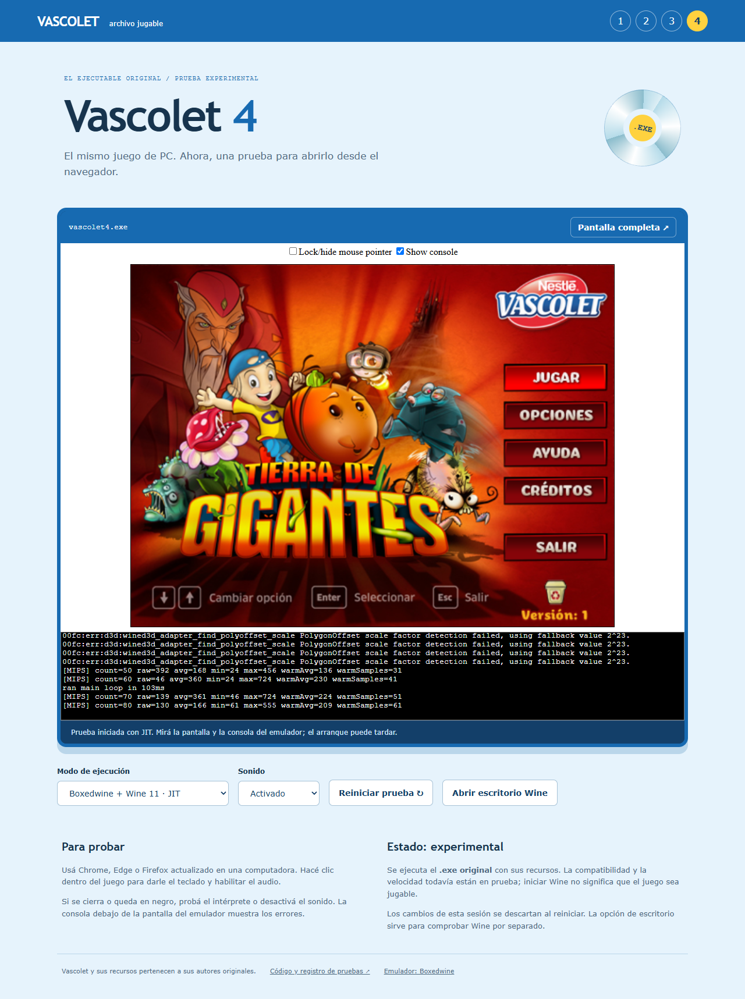

# Registro de prueba — Vascolet 4

Fecha: 2026-11-01. Prueba local HTTP en Chromium headless con Playwright,
WebGL mediante SwiftShader, modo single-thread JIT, sonido activado.

## Resultado observado

Menú original visible: Jugar, Opciones, Ayuda, Créditos y Salir.

Wine arrancó, cargó el ejecutable y activó WineD3D con el perfil WebGL.
No se registraron excepciones JavaScript ni peticiones de recursos fallidas.
Vascolet 1 necesitó añadir OpenAL32.dll; la misma dependencia faltaba en 2 y 3.

[Consola de la prueba](docs/startup.log)

## Alcance

Esta evidencia comprueba el arranque y la pantalla inicial renderizada, no una
partida completa. No se certificaron aún fluidez, sonido audible, guardado,
todos los niveles ni el modo intérprete. SwiftShader es un renderizador software;
el rendimiento con la GPU real del visitante puede ser distinto.

## Repetir manualmente

1. Abrir la página en Chrome/Edge/Firefox actualizado en PC.
2. Dejar JIT y pulsar Iniciar juego. Esperar la primera descarga y el arranque.
3. Hacer clic dentro del juego y usar su menú o Enter para continuar.
4. Comprobar movimiento, salto, audio y al menos un nivel.
5. Si hay fallos, guardar la consola y anotar navegador, GPU y pantalla exacta.
6. Reiniciar con intérprete o sin sonido y comparar.
