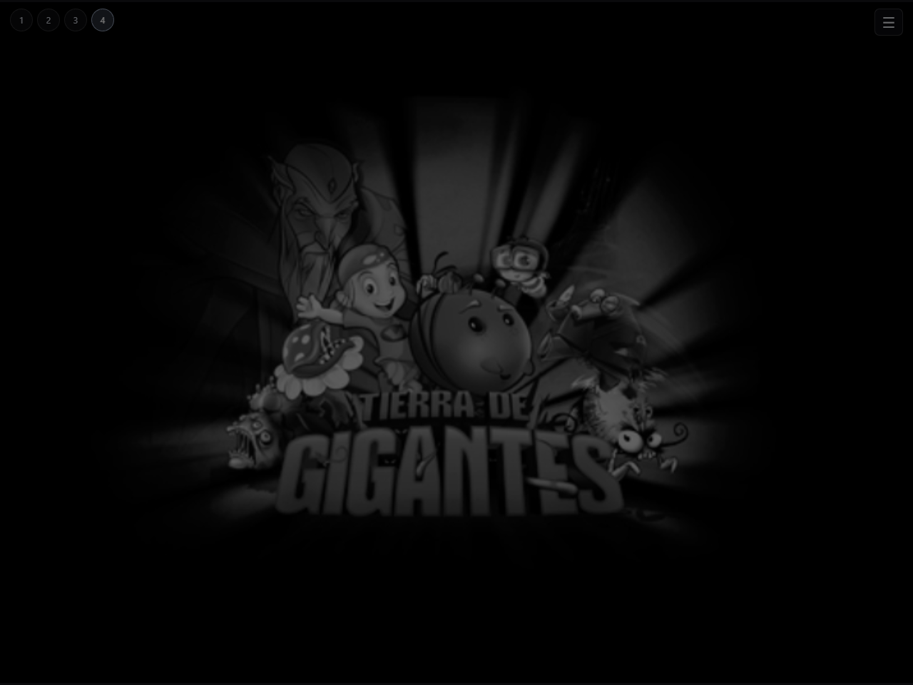

# Pruebas

La versión actual se probó en Chromium con WebGL por software, modo multihilo
aislado, teclado y ratón. Los cuatro ejecutables superan el inicio y responden.
Ver [investigación y mediciones](docs/PERFORMANCE.md) para los límites.

Las capturas antiguas `startup.png` y `startup.log` documentan la primera
versión, anterior al cambio de interfaz. No describen el rendimiento actual.
